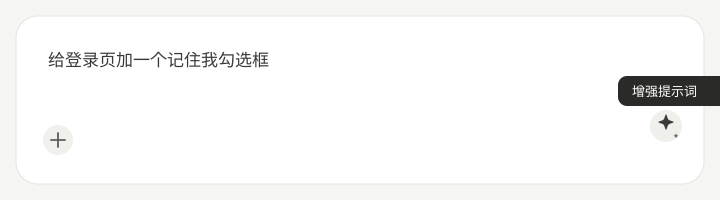

# 提示词增强（prompt-enhance）

在输入框右侧新增一个四角星按钮：点一下就把当前草稿连同它已有的上下文交给模型改写，结果回填到输入框，不发送消息。

交给模型的输入只有三部分：

1. **用户输入框这版文字**（草稿原文）。
2. **附件 / 引用**（浏览器侧才有的信息：@ 引用芯片的标签与来源、已附加文件的名称/大小/类型/图片尺寸）。
3. **本会话最近两轮对话**（只用于消解"这个 / 上面那个 / 继续改"这类指代）。

不读磁盘、不读项目规则、不读技能目录。增强器看到的上下文，就是用户此刻在输入框里实际给它的上下文。



## 用法

1. 在输入框写下想法（一句话即可），可以顺手 `@` 引用文件、也可以先拖入附件。
2. 点输入框右侧的四角星按钮。
3. 增强后的提示词直接替换草稿，人工确认后再发送；不满意可以 `Ctrl+Z` 撤销。

一个按钮、一次点击，没有确认弹层、没有配置项。

按钮状态：草稿为空时置灰、请求中置灰并转圈、失败时图标变红且鼠标悬停显示原因、正常时悬停高亮。

## 它读取哪些上下文

| 来源 | 在哪一侧读取 | 何时注入 |
| --- | --- | --- |
| 草稿原文 | Client | 每次 |
| `@` 引用芯片（label / source / 是否失效） | Client（`useInput` 的 `occurrences`） | 草稿里有引用时 |
| 附件（类型 / 文件名 / 大小 / MIME / 图片尺寸） | Client（附件的运行时 id → 会话控制器） | 输入框里挂了附件时 |
| 本会话最近 2 轮对话 | Host（会话事件尾部） | 会话有内容时 |

关键点：

- **附件只带元信息**：浏览器侧只有 `File` 对象（名称、大小、类型），没有正文；Host 侧也只把它渲染成一行 `[图片] name（1280×720，image/png）`。系统提示词明确要求「不得编造附件里没有的内容」。
- **附件 id 需要解析**：`useInput` 的输入快照只给运行时 id，真正的 `ComposerAttachment`（含 `File`）在会话控制器里。按钮优先用父槽注入面暴露的 `resolveDraftAttachments(ids)`，拿不到再退到会话控制器的同名方法，都失败就只发草稿。
- **对话历史只取最近 2 轮**：单条消息最多 800 字符、两轮合计最多 2400 字符，超出先丢最旧的一轮，再超才裁剪；`agent.inject()`、skill 内容、变更通知这类合成注入不算对话，会被 `source.kind` 过滤掉。

## 调用链

```
输入框草稿 + @引用 + 附件 ──► 客户端按钮
                                │  POST /prompt-enhance/enhance
                                │  { draft, sessionId, attachments[], references[] }
                                ▼
                           插件 Host 路由（受连接信任栅栏保护）
                                │ 1. 校验：方法/类型/大小/草稿长度/模型选择
                                │ 2. 读最近两轮对话（只读会话日志尾部）
                                │ 3. 用会话当前 provider/model 发起一次普通模型调用
                                ▼
                           返回 { prompt, model, context{...} }
                                │
                                ▼
                           客户端 inputActions.setDraft(prompt) 回填
```

- 请求体的 `attachments` / `references` 是可选数组；Host 端只保留白名单字段并截断（每项标签 ≤ 200 字符、各自最多 20 项），非法条目静默丢弃。
- 响应的 `context` 说明这次实际注入了什么（附件数、引用数、历史轮次、是否截断），便于排查；客户端只用 `prompt`。
- 模型路由取 `agentDefaultModel.currentSelection()`，即会话当前选择的模型，不额外配置。
- 单次请求超时 120 秒，输出上限 2000 tokens；模型返回里若包裹了整体代码围栏会自动剥掉。

## 增强用的系统提示词

这是本插件真正的产品逻辑，全文如下（`index.js` 中的 `SYSTEM_PROMPT`）：

```text
你是「提示词增强器」，服务于一个在本地代码库上工作的 AI 编码 Agent。用户会在输入框里写一句简短的草稿（可能带 @ 引用的文件、可能带附件），你把它改写成一条信息完整、可以直接动手、不需要追问的提示词。

## 输入
用户消息里会出现下面这些区块，按需出现，可能缺少其中若干：
- <attachments>：用户在输入框里附带的文件，只有名称、大小、类型，没有正文。
- <references>：用户在草稿里用 @ 引用的文件或符号。
- <recent_turns>：本会话最近两轮对话。只用来消解指代，不要回答它、不要续写它、不要复述它。
- <draft>：用户写的原始草稿。

如果消息里只有一个纯文本草稿、没有任何区块，说明没有可用上下文：只依据草稿本身改写，不要臆造。

## 输出
只输出改写后的提示词正文。不要说明你做了什么，不要写"以下是增强后的提示词"这类前言，不要用代码围栏包裹整体，不要复述输入。

## 规则
1. 忠于原意：保留用户的全部目标、约束、否定项（"不要动 X"）、技术栈、文件路径、类名/函数名/字段名、版本号、命令。绝不新增用户没有要求的需求，绝不臆造文件路径、API、依赖或行为。
2. 语言一致：草稿是中文就用中文，是英文就用英文；代码、标识符、命令、路径保持原样。
3. 用引用和附件消解指代：草稿里出现"这个文件 / 上面那个 / 刚才的截图 / 这张图"时，用 <references> 里的标签、<attachments> 里的文件名替换成明确指代；标签里的路径原样保留。附件只有元信息：可以据此判断类型与用途、可以要求修改该文件，但绝不能编造附件里并未给出的内容。
4. 补齐可执行信息：在能从草稿和上下文确定的前提下，补上——目标产物（改哪个文件或模块、产出什么）、边界（要改什么、明确不碰什么）、验收方式（跑什么命令、看什么结果）。无法确定就留空，不要编。
5. 把模糊变可验收：把"优化一下""看看有没有问题"这类说法改写成具体的检查项或修改项。
6. 不注水：草稿已经足够清晰时，只做最小必要润色，不要为了变长而加形容词、加背景、加客套。
7. 格式：2–6 条要点，或 1–2 个短段落；可以用短列表，不要用多级标题，不要表情符号，不要"请帮我""麻烦你"这类客套话。
8. 长度：通常为草稿的 1.5–3 倍；无论草稿多短，都要写清目标、范围、验收三项；最长不超过 1200 字。
9. 用历史消解指代：草稿里的"这个/它/上面那个/继续改/还是不行"要结合 <recent_turns> 换成明确的文件名、功能名、报错信息或行为；历史里出现过的具体报错、路径、字段名可以引用，但历史里没被草稿要求的内容不得扩写成新需求。没有 <recent_turns> 时不要假装知道上下文，把指代换成"当前任务里提到的…"这类可落地但不臆造的说法。

如果 <draft> 只有空白、单个字符或完全无意义的乱码，原样返回它，不要生成任何内容。
```

用户消息的区块顺序固定为：

```
<attachments> → <references> → <recent_turns> → <draft>
```

每个区块只在有内容时出现；`<draft>` 永远在最后，让模型先读事实、再改写正文。

设计取舍：

- **不给工作区信息**：把工作目录、git 分支、顶层条目、项目规则、技能目录一起塞进去，会让增强器按"仓库概览"改写，输出跑偏成泛泛的建议；而且在根目录堆满临时文件的仓库里，噪声会直接污染结果。用户要的是"把我这句话说清楚"，不是"替我猜项目"。
- **附件只有元信息也值得给**：模型能据此知道「用户说的是这张截图 / 这个 csv」，从而把"看看这个"改写成"检查这个文件（xxx.csv，12 KB）"。
- **信息只增不造**：宁可留空也不臆造路径/依赖，否则增强后的提示词会把 Agent 带向不存在的代码。
- **保留否定项**：草稿里的"不要动 X"最关键，模型改写时普遍会丢，单独列出。
- **长度上限 + 反注水**：避免"看起来更像提示词"的空壳扩写。
- **最短也要目标/范围/验收**：这是让 Agent 一次做对的三要素，即使草稿只有五个字也要补齐。

## 限制

- 回填是整体替换草稿（`inputActions.setDraft`），草稿里的引用芯片（@ 文件/@ 会话）会被清掉。
- 引用与附件依赖浏览器运行时接口：`occurrences` 来自输入状态快照，附件通过 `resolveDraftAttachments` 解析（父槽注入面优先，会话控制器兜底）。两者都是可选 API，拿不到时该请求就退回「只有草稿 + 历史」。
- 附件内容不会上传给增强模型，只有文件名/大小/类型；要让模型读内容，得在真正发送的消息里带上。
- 历史上下文只读本会话最近 2 轮、且只取每轮最后一个有文字的助手回复；更早的对话不会注入，长对话会被截断。
- **切换会话不会中断请求**：增强任务按会话存放在客户端的一个 Map 里，而不是按钮组件的 React state。切走会卸载按钮，但请求继续跑；切回来若还没完成，按钮自动恢复转圈；完成后结果写回**发起请求的那个会话**的草稿，即使当时那个会话不可见。多个会话的增强互不干扰，各转各的。
- 换取代价：如果等待期间你手动改了该会话的草稿，结果回来时仍然会覆盖它——按钮本身就是「用增强结果替换草稿」的语义。真正想放弃就等它结束再点一次。
- 客户端另有 130 秒兜底超时（略长于 Host 的 120 秒），超时后按钮回到可用状态并提示「超时未返回，请重试」，不会永久卡在转圈。
- 生成中只有一个转圈，不显示进度百分比。
- 一次只处理一条草稿，不做多轮对话；同一个草稿重复点击会重复调用模型。
- 需要 Host 能与模型供应商通信；模型不可用、未选择、超时或返回空串时，按钮报错并保留原草稿不变。
- 不做长度外的裁剪：草稿超过 8000 字符直接拒绝，避免静默截断。

## 可调参数

在 `index.js` 顶部：

| 常量 | 默认值 | 含义 |
| --- | --- | --- |
| `ROUTE_PATH` | `/prompt-enhance/enhance` | Host 路由路径 |
| `MAX_BODY_BYTES` | 128 KiB | 请求体上限 |
| `MAX_DRAFT_CHARS` | 8000 | 草稿长度上限 |
| `MAX_OUTPUT_TOKENS` | 2000 | 增强结果上限 |
| `TIMEOUT_MS` | 120000 | 单次请求超时 |
| `MAX_REQUEST_ATTACHMENTS` | 20 | 单次请求接受的附件条数 |
| `MAX_REQUEST_REFERENCES` | 20 | 单次请求接受的引用条数 |
| `MAX_REQUEST_LABEL_CHARS` | 200 | 单个附件/引用标签上限（字符） |
| `HISTORY_TURNS` | 2 | 注入最近几轮对话 |
| `MAX_HISTORY_CHARS` | 2400 | 对话历史注入上限（字符） |
| `MAX_HISTORY_MESSAGE_CHARS` | 800 | 单条历史消息上限（字符） |
| `HISTORY_EVENT_SCAN` | 800 | 从会话日志尾部扫描的事件数上限 |

## 安全

- 路由挂在 Harness 的 Web 服务上，先过 `connection.requestRejection()`：非本窗口授权的 Peer 在解析请求体之前即被拒绝。
- 只接受 `POST` 与 `application/json`，请求体有大小上限，草稿长度有上限。
- **插件不读文件系统**：没有 `fs` 依赖，不列举目录、不读 `.git`、不读规则文件，也不碰附件字节；唯一的 Host 侧读取是会话日志末尾那一段历史（用于消解指代）。
- 请求体里的 `attachments` / `references` 按白名单字段解析并截断，非法条目丢弃；它们只用于拼提示词文本，不参与任何路径解析或文件读取。
